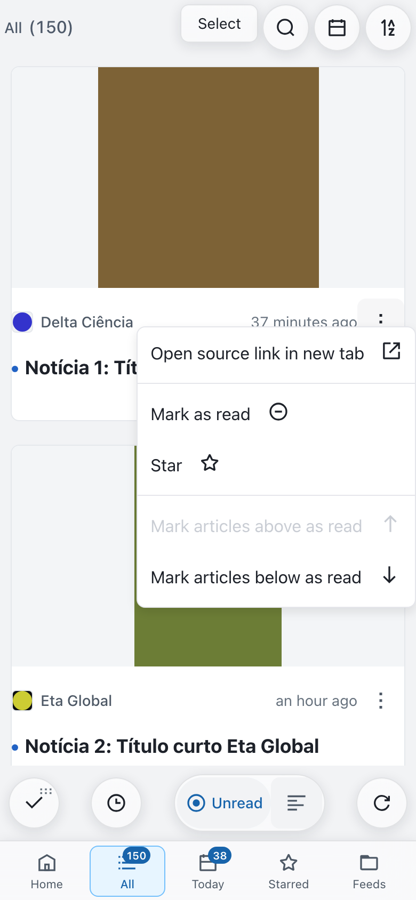
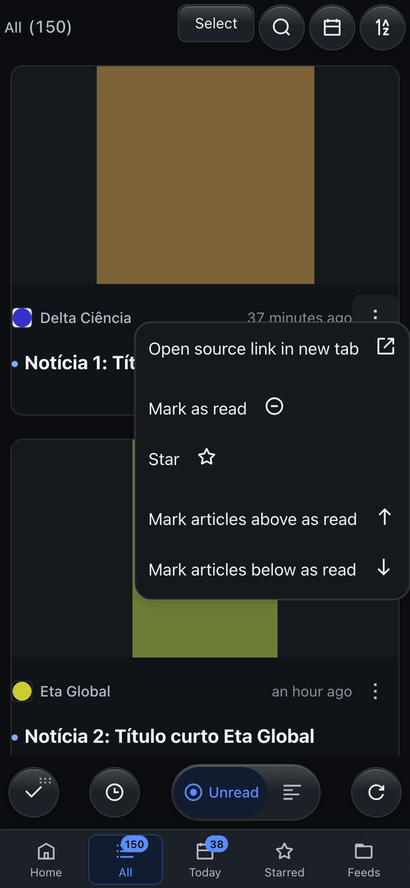
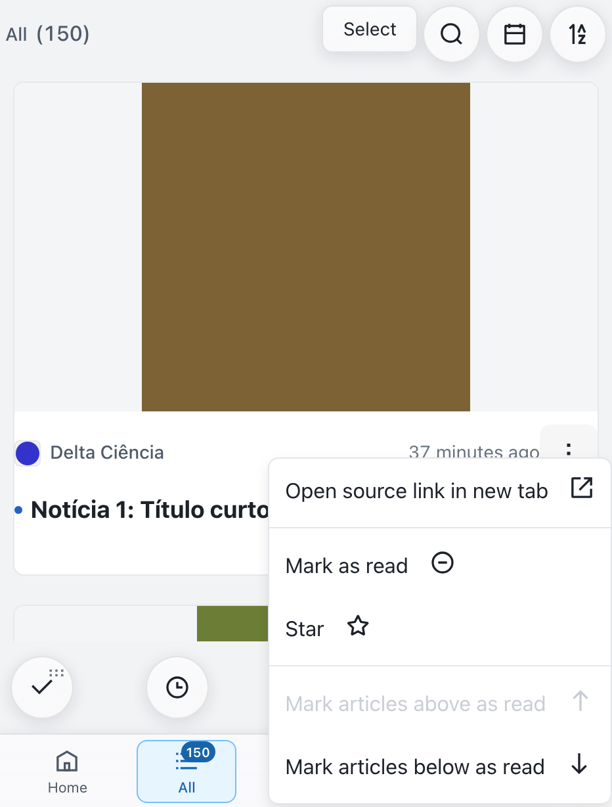
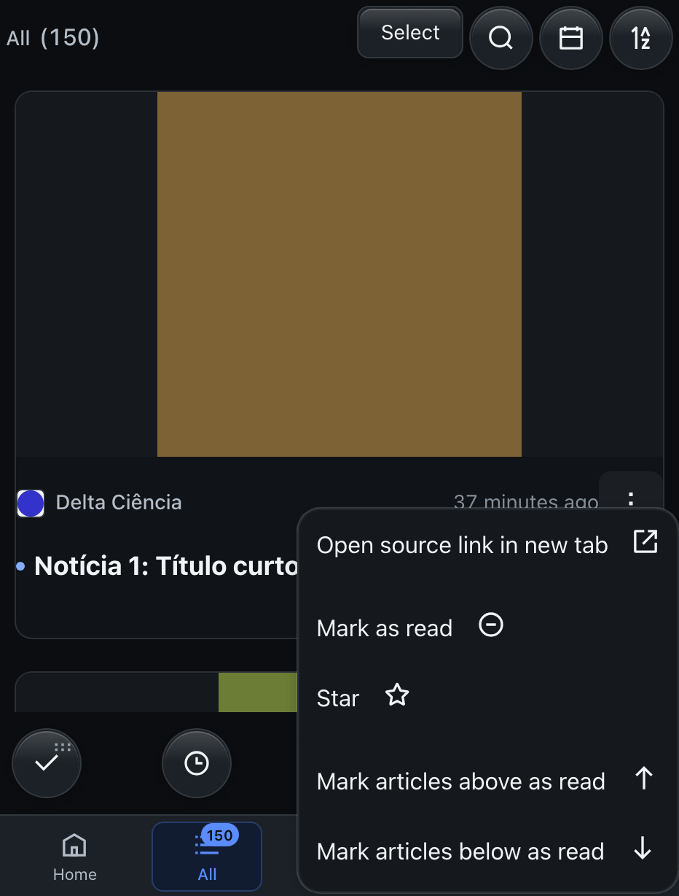
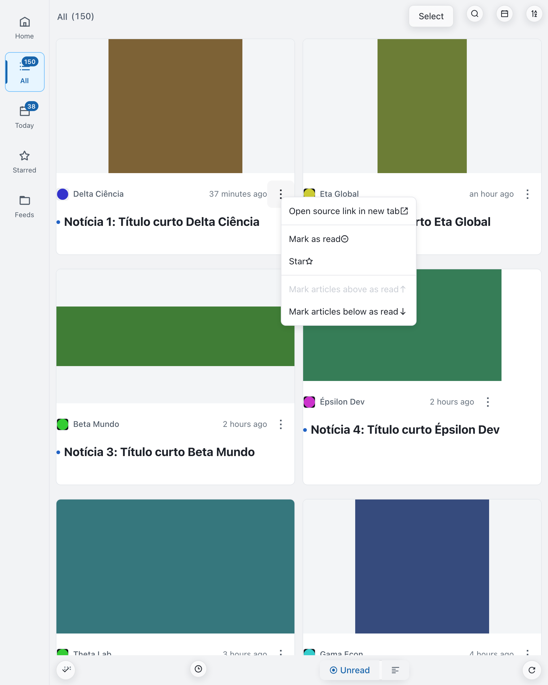
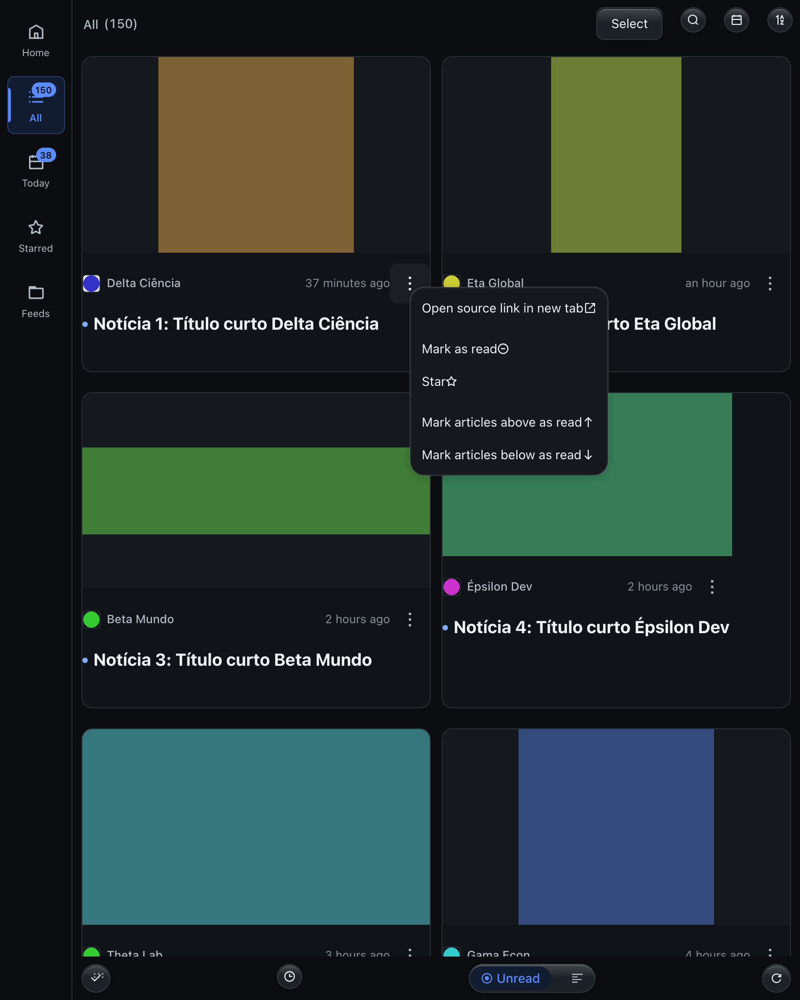

# CARD-QUICK-ACTIONS-01 visual evidence

The screenshots were captured by the Playwright Chromium harness against the synthetic Miniflux backend. Each image shows the existing action menu opened from the new card button.

| Emulated viewport                      | Light                                                                                          | Dark / OLED                                                                                            |
| -------------------------------------- | ---------------------------------------------------------------------------------------------- | ------------------------------------------------------------------------------------------------------ |
| Compact mobile · 390×844               |               |               |
| Surface Duo closed · 466×614           |       |       |
| Surface Duo open / critical · 884×1104 |  |  |

The visual gate checks the 44×44 px target, button bounds, title/image overlap, horizontal overflow, card opacity, and a minimum 4.5:1 icon-to-card contrast. The application currently uses the same dark palette for Dark and OLED.

`REAL_DEVICE_GATE=NOT_RUN`: these are browser emulations, not physical Surface Duo or mobile device results.
