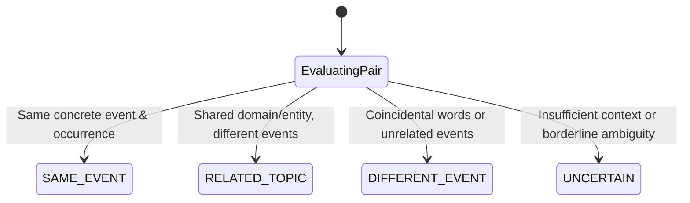

# STORY01B Research: Story Identity Corpus and Label Contract

- **Track:** STORY-01B-R
- **Topic:** Story Identity Corpus Contract, Feature Taxonomy, Label Specification, and Review Queue Design
- **NewsFlux Base Commit:** `dc4154d7729204c65c8a1abaa50f9bfc9f92be64`
- **Date:** 2026-10-25
- **Status:** COMPLETE / RESEARCH ONLY
- **Runtime Activation:** NONE (`NO PRODUCT ACTIVATION`, `MERGE=NO`, `DEPLOY=NO`)
- **Feature Schema Version:** `story01b-pair-v1`

---

## 1. Objective and Product Boundaries

The purpose of this contract is to establish the formal empirical dataset, feature schema, and annotation contract for the NewsFlux **Story Identity Engine**.

The future product projection for Story Identity is strictly bounded:

- **HOME:** May eventually group `SAME_EVENT` articles editorially to declutter breaking news coverage.
- **ALL:** Remains strictly chronological, article-level, and unclustered (`ALL_CLUSTERING=NO`).
- **UNREAD:** Remains strictly chronological, article-level, and unclustered (`UNREAD_CLUSTERING=NO`).
- **MINIFLUX UPSTREAM:** Zero mutations (`MINIFLUX_WRITES=0`); no category, feed, or entry changes. Miniflux remains the authoritative source-of-truth for article, feed, category, read, and star state.
- **STORAGE GOVERNANCE:** `STORY_IDENTITY_PRODUCTION_STORAGE=HOLD_ARCHITECTURE_DECISION`. No new persistent state is authorized in this track (`NEW_PRODUCTION_PERSISTENT_STATE_AUTHORIZED=NO`).
- **READ CASCADE:** Strictly prohibited (`READ_CASCADE=PROHIBITED`); marking one article read never marks its cluster siblings read.
- **PERSONALIZATION INVARIANCE:** Personalization signals (read status, starred entries, user scoring, reading history, folder arrangement) **MUST NOT** define or alter `SAME_EVENT` boundaries. `SAME_EVENT` is an objective property of the published articles and the real-world events they report.

---

## 2. Frozen Story00 Research Corpus (Home-200)

The research baseline utilizes the frozen `Home-200` corpus snapshot:

| Dimension                         | Value / Specification                                                                                                          |
| :-------------------------------- | :----------------------------------------------------------------------------------------------------------------------------- |
| **Corpus Snapshot Path**          | `/Users/jfsdias/NewsFlux-STORY00/private-p4/20261023-220212/home-200.jsonl`                                                    |
| **Corpus Byte SHA256 (Disk)**     | `0dbd48cdb37063f3a1683f7ef8fc9a2582196a2e8d42c34485b85e12242178f0` (`CORPUS_FILE_SHA256`)                                      |
| **Declared Corpus Fingerprint**   | `c12842f11c2bb3e941f182ed946e6a98ae6c70bb69ea8e7908285506af8a2ed8` (`DECLARED_CORPUS_FINGERPRINT`)                             |
| **Fingerprint Derivation**        | `CORPUS_FINGERPRINT_DERIVATION=HISTORICAL_ARTIFACT_DECLARATION`                                                                |
| **Corpus Hash Semantics**         | `CORPUS_HASH_SEMANTICS=EXPLICIT` (file verification relies on disk byte SHA256)                                                |
| **Total Entries**                 | `200` articles                                                                                                                 |
| **Total Feeds**                   | `37` distinct feeds                                                                                                            |
| **Total Categories**              | `10` distinct categories                                                                                                       |
| **Observed Temporal Span**        | `2026-10-23` to `2026-10-24` (`HOME200_OBSERVED_TEMPORAL_SPAN≈6.95h`, $\min \Delta = 0.0\text{h}, \max \Delta = 6.95\text{h}$) |
| **True Event Distribution**       | `SAME_EVENT_TEMPORAL_DISTRIBUTION=NOT_MEASURED_PENDING_STORY_01B_D`                                                            |
| **Declared Languages**            | Portuguese (`pt`): 97, English (`en`): 70, Unset: 33                                                                           |
| **Heuristic Effective Languages** | Portuguese (`pt`): 121, English (`en`): 71, Undetermined (`und`): 8                                                            |
| **Fields Collected**              | `id`, `feed_id`, `feed_title`, `category_id`, `title`, `url`, `published_at`, `language`                                       |
| **Article Bodies Collected**      | `NO` (Headlines, metadata, and canonical URLs only)                                                                            |

### 2.1 Precomputed Embedding Artifacts and Vector Parity Gate

The frozen corpus includes precomputed dense embeddings from two distinct model families:

1. **Qwen3-Embedding-0.6B:**
   - File: `r3a-bakeoff-v1/qwen-embeddings.json`
   - Model Identifier: `qwen3-embedding:0.6b` (digest `ac6da0dfba...`)
   - Vector Count: `QWEN_VECTOR_COUNT=200`
   - Dimension: `QWEN_ALL_VECTOR_DIMENSIONS=1024` (validated for all 200 vectors)
   - Order Alignment: IDs in `qwen-embeddings.json` match `home-200.jsonl` entry IDs 1-to-1 in identical order.
2. **Mistral-Embed:**
   - Files: `r3a-bakeoff-v1/mistral-batch-*.json` (4 sequential batches $\times$ 50 entries)
   - Model Identifier: `mistral-embed`
   - Vector Count: `MISTRAL_VECTOR_COUNT=200`
   - Dimension: `MISTRAL_ALL_VECTOR_DIMENSIONS=1024` (validated for all 200 vectors across all 4 batches)
   - Order Alignment: Batches partition the 200 corpus entries into exact sequential intervals `[0..49]`, `[50..99]`, `[100..149]`, `[150..199]`.
3. **Semantic Vector Parity Gate:**
   - Recomputing cosine similarities directly from raw unit-normalized vectors reproduces the precomputed scores in `all-crossfeed-168h-pairs.csv` within numeric tolerance $< 5\times 10^{-9}$ across all 18,953 pairs:
     - `QWEN_COSINE_DERIVED_FROM_VECTOR=PASS`
     - `MISTRAL_COSINE_DERIVED_FROM_VECTOR=PASS`
     - `PAIR_SCORE_PARITY_GATE=PASS`

### 2.2 Candidate Pairs Universe

- File: `r3a-bakeoff-v1/all-crossfeed-168h-pairs.csv`
- Total Pairs: `18,953` cross-feed pairs within 168 hours
- File SHA256: `bd50a4d4e316e2bdd0b6735c1df8c3fe52f6dc14878923325dd2794cfeb3eb14`
- Cross-Feed Constraint: All pairs satisfy `feed_id_a != feed_id_b` ($100\%$).
- Canonical Order: `pair_key = f"{min(id_a, id_b)}:{max(id_a, id_b)}"`.

### 2.3 Cross-Encoder Reranker Artifacts

- File: `r3a-bakeoff-v1/r3b-qwen3-reranker-0.6b-top250/r3b-qwen3-reranker-top250.csv`
- Model: `Qwen/Qwen3-Reranker-0.6B` @ revision `e61197ed45024b0ed8a2d74b80b4d909f1255473`
- Evaluated: Top 250 candidate pairs from the candidate universe
- Directional Fields: `reranker_score_ab`, `reranker_score_ba`, `reranker_score_mean`, `reranker_direction_delta = |ab - ba|`.

---

## 3. Feature Schema and Availability Audit (`FEATURE_SCHEMA_VERSION = story01b-pair-v1`)

The pairwise feature schema formalizes all feature dimensions, their source, availability, and mathematical definitions:

| Feature Name                    | Type        | Source            | Availability    | Definition                                                    |
| :------------------------------ | :---------- | :---------------- | :-------------- | :------------------------------------------------------------ |
| `pair_key`                      | `string`    | Derived           | `AVAILABLE_NOW` | Canonical key `"{min(id_a, id_b)}:{max(id_a, id_b)}"`.        |
| `id_a`, `id_b`                  | `int`       | Miniflux Entry    | `AVAILABLE_NOW` | Entry IDs of the article pair.                                |
| `feed_id_a`, `feed_id_b`        | `int`       | Miniflux Feed     | `AVAILABLE_NOW` | Feed IDs (`feed_id_a != feed_id_b`).                          |
| `cross_feed`                    | `int (0/1)` | Derived           | `AVAILABLE_NOW` | 1 if `feed_id_a != feed_id_b`, else 0.                        |
| `same_category`                 | `int (0/1)` | Miniflux Category | `DERIVABLE_NOW` | 1 if `category_id_a == category_id_b`, else 0.                |
| `canonical_url_match`           | `int (0/1)` | Article URL       | `DERIVABLE_NOW` | 1 if raw URLs are identical, else 0.                          |
| `normalized_url_match`          | `int (0/1)` | Article URL       | `DERIVABLE_NOW` | 1 if URLs match after stripping query/tracking params.        |
| `same_domain`                   | `int (0/1)` | Article URL       | `DERIVABLE_NOW` | 1 if URL hostnames match, else 0.                             |
| `publication_delta_minutes`     | `float`     | Entry Timestamps  | `AVAILABLE_NOW` | $                                                             | t_A - t_B    | / 60.0$.                   |
| `publication_delta_hours`       | `float`     | Entry Timestamps  | `AVAILABLE_NOW` | $                                                             | t_A - t_B    | / 3600.0$.                 |
| `same_calendar_day_utc`         | `int (0/1)` | Entry Timestamps  | `AVAILABLE_NOW` | 1 if UTC publication dates match `YYYY-MM-DD`.                |
| `exact_normalized_title`        | `int (0/1)` | Article Titles    | `AVAILABLE_NOW` | 1 if normalized titles match exactly, else 0.                 |
| `title_token_intersection`      | `int`       | Article Titles    | `AVAILABLE_NOW` | Count of shared non-numeric significant words.                |
| `title_overlap_coefficient`     | `float`     | Article Titles    | `AVAILABLE_NOW` | $                                                             | W_A \cap W_B | / \min(                    | W_A          | ,                       | W_B | )$ on significant words. |
| `title_jaccard`                 | `float`     | Article Titles    | `AVAILABLE_NOW` | $                                                             | W_A \cap W_B | /                          | W_A \cup W_B | $ on significant words. |
| `significant_word_count_a`      | `int`       | Article Titles    | `AVAILABLE_NOW` | Count of significant lexical words in title A.                |
| `significant_word_count_b`      | `int`       | Article Titles    | `AVAILABLE_NOW` | Count of significant lexical words in title B.                |
| `number_overlap`                | `int`       | Article Titles    | `DERIVABLE_NOW` | Count of shared pure numeric tokens ($                        | N_A \cap N_B | $).                        |
| `date_overlap`                  | `int`       | Article Titles    | `DERIVABLE_NOW` | Count of shared year/date tokens ($                           | D_A \cap D_B | $).                        |
| `qwen_embedding_cosine`         | `float`     | Qwen Vectors      | `AVAILABLE_NOW` | Cosine similarity between Qwen 1024-dim vectors.              |
| `mistral_embedding_cosine`      | `float`     | Mistral Vectors   | `AVAILABLE_NOW` | Cosine similarity between Mistral 1024-dim vectors.           |
| `qwen_reranker_ab`              | `float`     | Qwen3-Reranker    | `AVAILABLE_NOW` | Directional logit $A \to B$ (available for Top 250).          |
| `qwen_reranker_ba`              | `float`     | Qwen3-Reranker    | `AVAILABLE_NOW` | Directional logit $B \to A$ (available for Top 250).          |
| `qwen_reranker_mean`            | `float`     | Qwen3-Reranker    | `AVAILABLE_NOW` | Symmetric mean logit $(ab + ba) / 2$ (available for Top 250). |
| `qwen_reranker_direction_delta` | `float`     | Qwen3-Reranker    | `AVAILABLE_NOW` | Asymmetry $                                                   | ab - ba      | $ (available for Top 250). |
| `person_overlap`                | `int`       | Named Entities    | `DEFERRED`      | `ENTITY_FEATURES=DEFERRED` (requires offline NER model).      |
| `organization_overlap`          | `int`       | Named Entities    | `DEFERRED`      | `ENTITY_FEATURES=DEFERRED` (requires offline NER model).      |
| `location_overlap`              | `int`       | Named Entities    | `DEFERRED`      | `ENTITY_FEATURES=DEFERRED` (requires offline NER model).      |
| `product_overlap`               | `int`       | Named Entities    | `DEFERRED`      | `ENTITY_FEATURES=DEFERRED` (requires offline NER model).      |
| `entity_proxy_overlap`          | `int`       | Article Titles    | `AVAILABLE_NOW` | Shared capitalized anchor tokens (deterministic proxy).       |

### 3.1 Numeric Token Separation

Pure numeric tokens (e.g. "40", "2026", "27") are excluded from `significant_words` to prevent numbers from silently inflating lexical overlap metrics. Numbers and dates are measured as dedicated independent features:

- `number_overlap`: Count of intersecting pure digit tokens.
- `date_overlap`: Count of intersecting year and calendar date tokens.

### 3.2 Score Scale Incompatibility Constraint

$$\text{RAW\_EMBEDDING\_SCORE\_FUSION} = \text{PROHIBITED}$$

Qwen and Mistral embeddings have fundamentally different cosine distributions:

- Qwen cosine scores for high-similarity pairs range from $0.70$ to $0.88$.
- Mistral cosine scores for high-similarity pairs range from $0.85$ to $0.96$.

Averaging raw cosine similarities (e.g. $\frac{\text{Qwen} + \text{Mistral}}{2}$) is mathematically invalid and prohibited. They must remain separate features in the schema.

---

## 4. Pair-Label Taxonomy

The labeling contract defines four mutually exclusive classes:

### 4.1 Taxonomy Definitions

#### 1. `SAME_EVENT`

Both articles report on the **exact same underlying news event or real-world occurrence** (identical _who, what, when, where_).

- _Criterion:_ A reader who reads Article A and then reads Article B learns about the same event from another publisher's perspective.
- _Examples:_
  - _Outbreak reporting:_ "Anvisa suspende lote de medicamento por contaminação" vs. "Lote de remédio é interditado pela Anvisa após contaminação".
  - _Product release:_ "Alpha releases platformOS 10.2 RC" vs. "platformOS 10.2 RC now available to developers".
  - _Casting announcement:_ "‘Estúdio Alfa’ confirma atriz premiada para nova franquia de cinema" vs. "Nova franquia de cinema: atriz premiada é confirmada pelo Estúdio Alfa".

#### 2. `RELATED_TOPIC`

Articles share a **common entity, company, person, ongoing broad subject, or theme**, but report on **distinct events, different developments, analyses, previews, or follow-ups**.

- _Criterion:_ Articles share context, but one does not substitute for the other. Merging them into a single card would hide a distinct event from the reader.
- _Examples:_
  - _Entity overlap, different products:_ "Alpha Corp reports Q4 earnings" vs. "Alpha Corp announces new tablet device".
  - _Ongoing conflict/policy:_ "Senate debates new tax reform bill" vs. "President signs executive decree on agricultural subsidies".
  - _Sports:_ "Team A manager previews tomorrow's match" vs. "Team A signs new striker for next season".

#### 3. `DIFFERENT_EVENT`

Articles describe **completely separate events** with no substantive connection, even if they share broad domain vocabulary (e.g. technology, law, politics, sports) or common stopwords.

- _Examples:_
  - "Tesla opens new Supercharger station in Texas" vs. "Boeing faces FAA inspection on 737 fuselage".
  - "Sergipe recebe projeto do CNJ" vs. "STF julga recurso sobre previdência".

#### 4. `UNCERTAIN`

The pair is **genuinely ambiguous**, borderline, or cannot be resolved with certainty based solely on headline and metadata without inspecting full article text.

- _Criterion:_ Requires multi-judge adjudication or full-text fetch in `STORY-01B-D`.

---

## 5. Error Cost Asymmetry Policy

NewsFlux formally enshrines an asymmetric loss policy:

$$\text{Cost}(\text{False Merge}) \gg \text{Cost}(\text{False Split})$$

### 5.1 Rationale

1. **The Cost of a False Merge:**
   - When two articles about different events are merged, the non-representative article is hidden under the representative's card.
   - The reader misses an entire news story.
   - Editorial trust is compromised.
2. **The Cost of a False Split:**
   - When two articles about the same event are not merged, both appear as separate chronological cards in the feed.
   - This merely preserves the status quo of standard RSS readers (NewsFlux's current baseline).
   - Zero information is lost.

### 5.2 Algorithmic Consequence

- The classifier threshold must prioritize **precision over recall** for `SAME_EVENT`.
- Unrestricted transitive merging is completely disallowed:
  $$\text{UNRESTRICTED\_UNION\_FIND\_FOR\_FINAL\_CLUSTERING} = \text{REJECTED}$$
- Any clustering stage must enforce pairwise clique consistency or strict medoid/representative similarity.

---

## 6. Information-Rich Candidate Review Queue Design for STORY-01B-D

To prepare for human annotation in `STORY-01B-D`, the sampling engine selects an empirical, stratified candidate pool of **141 pairs** from the 18,953 candidate universe:

### 6.1 Stratified Strata Definitions

| Stratum Key | Stratum Name                 | Selection Rule                                                                                            | Pool Size | Sampled |
| :---------- | :--------------------------- | :-------------------------------------------------------------------------------------------------------- | :-------- | :------ |
| **Cat A**   | `HIGH_SEMANTIC_AGREEMENT`    | `qwen_rank <= 50` $\land$ `mistral_rank <= 50`                                                            | 11        | 11      |
| **Cat B**   | `QWEN_HIGH_MISTRAL_LOW`      | `qwen_rank <= 50` $\land$ `mistral_rank > 50`                                                             | 39        | 39      |
| **Cat C**   | `MISTRAL_HIGH_QWEN_LOW`      | `mistral_rank <= 50` $\land$ `qwen_rank > 50`                                                             | 39        | 39      |
| **Cat D**   | `LEXICAL_HIGH_SEMANTIC_LOW`  | `overlap_coefficient >= 0.3` $\land$ `best_rank > 150`                                                    | 9         | 9       |
| **Cat E**   | `SEMANTIC_HIGH_LEXICAL_LOW`  | `best_rank <= 50` $\land$ `overlap_coefficient <= 0.2` $\land$ `shared_words <= 1`                        | 27        | 10      |
| **Cat F**   | `TEMPORAL_HARD_NEGATIVE`     | (`best_rank <= 150` $\lor$ `overlap_coefficient >= 0.3`) $\land$ `delta_hours >= 4.0`                     | 36        | 10      |
| **Cat G**   | `ENTITY_PROXY_HARD_NEGATIVE` | Capitalized anchor token overlap $\ge 1$ $\land$ `best_rank > 250` (`ENTITY_STRATUM=DETERMINISTIC_PROXY`) | 321       | 10      |
| **Cat H**   | `OBVIOUS_NEGATIVE_CONTROL`   | `best_rank > 1000` $\land$ `shared_words == 0`                                                            | 17,047    | 15      |
| **Cat I**   | `DUPLICATE_TITLE_CROSS_FEED` | `exact_normalized_title == 1` $\lor$ `overlap_coefficient >= 0.8`                                         | 1         | 1       |
| **Cat J**   | `POTENTIAL_TRANSITIVE_CHAIN` | Weak bridge pairs ($A-C$ where $A-B \le 50, B-C \le 50$, but $A-C > 150$)                                 | 12        | 12      |

### 6.2 Empirical Queue Sizing Rationale (`PROPOSED_LABEL_QUEUE_SIZE = 141`)

- **Sum of Strata Allocations:** $11 + 39 + 39 + 9 + 10 + 10 + 10 + 15 + 1 + 12 = 146$.
- **Cross-Strata Overlap:** 5 pairs satisfy multiple criteria (e.g. duplicate title matching high semantic agreement).
- **Deduplicated Total:** Exactly **141 candidate pairs** (`PROPOSED_LABEL_QUEUE_SIZE=141`).
- **Rationale:**
  - **Complete Model Union Coverage:** 89 pairs (Cat A + Cat B + Cat C) guarantee 100% evaluation of the Story00 Bakeoff union.
  - **Boundary Discrimination:** 29 pairs (Cat D, E, F, G) force human adjudication on difficult lexical/semantic traps, temporal boundaries, and entity distractors.
  - **Structural Chaining Proof:** 12 pairs (Cat J) provide empirical ground truth on transitive chaining failure modes (`TRANSITIVE_CHAIN_CANDIDATE_COUNT=12`).
  - **Baseline Calibration:** 15 ambient controls (Cat H) protect against annotator false-positive drift.
  - **Human Burden Feasibility:** 141 pairs requires ~2.5 to 3.5 hours of human labeling, making double-blind adjudication in `STORY-01B-D` operationally practical.

### 6.3 Transitive Chain Candidate Detector

An offline triple detector searches the graph of strong pairs (`best_rank <= 50`) for candidate triples $(A, B, C)$ where $A-B$ and $B-C$ are strong, but $A-C$ is materially weaker (`best_rank > 150`).

- **Detected Triples:** `TRANSITIVE_CHAIN_CANDIDATE_COUNT = 12`.
- All 12 weak bridge pairs ($A-C$) are explicitly included in Stratum J of the review queue to empirically evaluate whether transitive merging would create false merges.

### 6.4 Blinding and Byte-Identical Reproducibility Protocol

- **Random Seed:** `RANDOM_SEED = 20261025`
- **Annotator Blinding (`ANNOTATOR_MODEL_BLINDING=PASS`):**
  - `story01b_annotator_queue.csv` contains only: `review_id`, `entry_a_id`, `entry_b_id`, `feed_a`, `feed_b`, `published_at_a`, `published_at_b`, `title_a`, `title_b`, `label`, `notes`.
  - All model names, similarity scores, ranks, and strata are stripped.
- **Audit Key:** `story01b_audit_key.csv` records complete research provenance and feature values.
- **Byte-Identical Reproducibility:**
  - Selected pair keys are sorted canonically before deterministic shuffling.
  - Repeated executions with the same seed yield bitwise identical CSVs:
    - `ANNOTATOR_QUEUE_BYTE_IDENTICAL=PASS`
    - `AUDIT_KEY_BYTE_IDENTICAL=PASS`
    - `SAMPLING_RECEIPT_BYTE_IDENTICAL=N/A_TIMESTAMPED` (receipt contains timestamp).
- **Private Output Guard (`PRIVATE_OUTPUT_PATH_GUARD=PASS`):**
  - Writing raw private article titles, feed names, or URLs inside the repository is strictly rejected unless verified by `git check-ignore`. Canonical output remains outside the repository (default `/tmp/newsflux-story01b-private/`).
  - `PRIVATE_ARTIFACT_TRACKED_BY_GIT=NO`.
