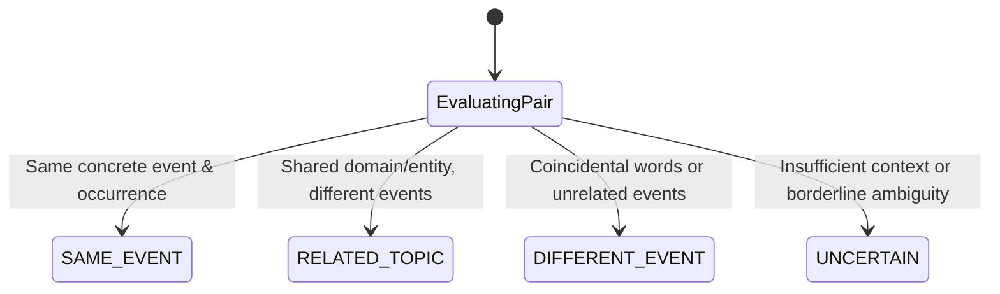

# STORY01B Research: Story Identity Corpus and Label Contract

- **Track:** STORY-01B-R
- **Topic:** Story Identity Corpus Contract, Feature Taxonomy, Label Specification, and Review Queue Design
- **NewsFlux Base Commit:** `dc4154d7729204c65c8a1abaa50f9bfc9f92be64`
- **Date:** 2026-10-25
- **Status:** COMPLETE / RESEARCH ONLY
- **Runtime Activation:** NONE (`NO PRODUCT ACTIVATION`, `MERGE=NO`, `DEPLOY=NO`)

---

## 1. Objective and Product Boundaries

The purpose of this contract is to establish the formal empirical dataset, feature schema, and annotation contract for the NewsFlux **Story Identity Engine**.

The future product projection for Story Identity is strictly bounded:

- **HOME:** May eventually group `SAME_EVENT` articles editorially to declutter breaking news coverage.
- **ALL:** Remains strictly chronological, article-level, and unclustered.
- **UNREAD:** Remains strictly chronological, article-level, and unclustered.
- **MINIFLUX UPSTREAM:** Zero mutations (`MINIFLUX_WRITES=0`); no category, feed, or entry changes.
- **READ CASCADE:** Strictly prohibited (`READ_CASCADE=PROHIBITED`); marking one article read never marks its cluster siblings read.
- **PERSONALIZATION INVARIANCE:** Personalization signals (read status, starred entries, user scoring, reading history, folder arrangement) **MUST NOT** define or alter `SAME_EVENT` boundaries. `SAME_EVENT` is an objective property of the published articles and the real-world events they report.

---

## 2. Frozen Story00 Research Corpus (Home-200)

The research baseline utilizes the frozen `Home-200` corpus snapshot:

| Dimension                         | Value / Specification                                                                                                                |
| :-------------------------------- | :----------------------------------------------------------------------------------------------------------------------------------- |
| **Corpus Snapshot Path**          | `/Users/jfsdias/NewsFlux-STORY00/private-p4/20261023-220212/home-200.jsonl`                                                          |
| **Corpus Fingerprint (Manifest)** | `c12842f11c2bb3e941f182ed946e6a98ae6c70bb69ea8e7908285506af8a2ed8`                                                                   |
| **File SHA256 (Disk)**            | `0dbd48cdb37063f3a1683f7ef8fc9a2582196a2e8d42c34485b85e12242178f0`                                                                   |
| **Total Entries**                 | `200` articles                                                                                                                       |
| **Total Feeds**                   | `37` distinct feeds                                                                                                                  |
| **Total Categories**              | `10` distinct categories                                                                                                             |
| **Temporal Span**                 | `2026-10-23` to `2026-10-24` (Dense real-world burst spanning `6.95` hours; $\min \Delta = 0.0\text{h}, \max \Delta = 6.95\text{h}$) |
| **Declared Languages**            | Portuguese (`pt`): 97, English (`en`): 70, Unset: 33                                                                                 |
| **Heuristic Effective Languages** | Portuguese (`pt`): 121, English (`en`): 71, Undetermined (`und`): 8                                                                  |
| **Fields Collected**              | `id`, `feed_id`, `feed_title`, `category_id`, `title`, `url`, `published_at`, `language`                                             |
| **Article Bodies Collected**      | `NO` (Headlines, metadata, and canonical URLs only)                                                                                  |

### 2.1 Precomputed Embedding Artifacts

The frozen corpus includes precomputed dense embeddings from two distinct model families:

1. **Qwen3-Embedding-0.6B:**
   - File: `r3a-bakeoff-v1/qwen-embeddings.json`
   - Model Identifier: `qwen3-embedding:0.6b`
   - Model Digest: `ac6da0dfba84a81fdbfbaf330198c33cd77c4cdfc53e8bc50eb581914a15621d`
   - Vector Dimension: `1024`
   - Entries: `200` vectors
2. **Mistral-Embed:**
   - Files: `r3a-bakeoff-v1/mistral-batch-*.json` (4 batches $\times$ 50 entries)
   - Model Identifier: `mistral-embed`
   - Vector Dimension: `1024`
   - Entries: `200` vectors

### 2.2 Candidate Pairs Universe

- File: `r3a-bakeoff-v1/all-crossfeed-168h-pairs.csv`
- Total Pairs: `18,953` cross-feed pairs within 168 hours
- File SHA256: `bd50a4d4e316e2bdd0b6735c1df8c3fe52f6dc14878923325dd2794cfeb3eb14`
- Cross-Feed Constraint: All pairs satisfy `feed_id_a != feed_id_b` ($100\%$).
- Canonical Order: `pair_key = f"{min(id_a, id_b)}:{max(id_a, id_b)}"`.

### 2.3 Cross-Encoder Reranker Artifacts

- File: `r3a-bakeoff-v1/r3b-qwen3-reranker-0.6b-top250/r3b-qwen3-reranker-top250.csv`
- Model: `Qwen/Qwen3-Reranker-0.6B` @ revision `e61197ed45024b0ed8a2d74b80b4d909f1255473`
- Evaluated: Top 250 candidate pairs from the candidate universe
- Scoring: Symmetric mean logit:
  $$\text{Score}_{\text{sym}}(A, B) = \frac{\text{logit}(A \to B) + \text{logit}(B \to A)}{2}$$

---

## 3. Pairwise Feature Schema and Extraction Rules

Every candidate article pair $(A, B)$ is represented by a deterministic feature vector:

```
+---------------------------------------------------------------------------------------+
|                                    PAIR IDENTITY                                      |
|  pair_key: str ("{min_id}:{max_id}")   |   id_a: int   |   id_b: int                  |
+---------------------------------------------------------------------------------------+
|                                  SOURCE METADATA                                      |
|  feed_id_a: int                        |   feed_id_b: int (feed_id_a != feed_id_b)     |
+---------------------------------------------------------------------------------------+
|                                 TEMPORAL FEATURES                                     |
|  published_delta_hours: float          |   same_calendar_day_utc: bool (0 / 1)        |
+---------------------------------------------------------------------------------------+
|                              LEXICAL & DETERMINISTIC                                  |
|  exact_normalized_title_match: bool    |   shared_significant_words_count: int        |
|  title_overlap_coefficient: float      |   title_jaccard_similarity: float            |
+---------------------------------------------------------------------------------------+
|                                  SEMANTIC DENSE                                       |
|  qwen_cosine_similarity: float         |   mistral_cosine_similarity: float           |
+---------------------------------------------------------------------------------------+
|                                CROSS-ENCODER RERANKER                                 |
|  reranker_score: float (symmetric mean logit if in Top-250, else None)               |
+---------------------------------------------------------------------------------------+
```

### 3.1 Feature Extraction Definitions

1. **Title Normalization:**
   - Lowercase string.
   - Punctuation removed via regular expression `[^\w\s]`.
   - Collapsed whitespace.
2. **Significant Words Extraction:**
   - Tokenized on word boundaries ($\ge 2$ alphanumeric characters).
   - Stopwords removed (bilingual Portuguese and English stopword list).
   - Feed title words removed to prevent publisher branding bias (e.g. "MacRumors", "Tecnoblog", "Ei Nerd").
3. **Lexical Overlap Metrics:**
   - **Intersection Count:** $|W_A \cap W_B|$
   - **Overlap Coefficient:**
     $$\text{Overlap}(A, B) = \frac{|W_A \cap W_B|}{\min(|W_A|, |W_B|)}$$
   - **Jaccard Similarity:**
     $$\text{Jaccard}(A, B) = \frac{|W_A \cap W_B|}{|W_A \cup W_B|}$$
4. **Temporal Features:**
   - `published_delta_hours`: $|t_A - t_B| / 3600.0$
   - `same_calendar_day_utc`: True if publication dates match in UTC `YYYY-MM-DD`.

### 3.2 Score Scale Incompatibility Constraint

$$\text{RAW\_EMBEDDING\_SCORE\_FUSION} = \text{PROHIBITED}$$

Qwen and Mistral embeddings have radically different cosine distributions:

- Qwen cosine scores for high-similarity pairs typically range from $0.70$ to $0.88$.
- Mistral cosine scores for high-similarity pairs typically range from $0.85$ to $0.96$.

Averaging raw cosine similarities (e.g. $\frac{\text{Qwen} + \text{Mistral}}{2}$) is mathematically invalid and strictly prohibited. They must remain distinct independent features in the schema or be normalized through rank percentiles before ensemble consideration.

---

## 4. Pair-Label Taxonomy

The labeling contract defines four mutually exclusive classes:



### 4.1 Taxonomy Definitions

#### 1. `SAME_EVENT`

Both articles report on the **exact same underlying news event or real-world occurrence** (identical _who, what, when, where_).

- _Criterion:_ A reader who reads Article A and then reads Article B learns about the same event from another publisher's perspective (syndication, wire report, competing reporting on the same press conference, announcement, or incident).
- _Examples:_
  - _Outbreak reporting:_ "Anvisa suspende lote de medicamento por contaminação" vs. "Lote de remédio é interditado pela Anvisa após contaminação".
  - _Product release:_ "Apple releases watchOS 27.2 Release Candidate" vs. "watchOS 27.2 RC now available to developers".
  - _Casting announcement:_ "‘Estúdio Alfa’ confirma atriz premiada para nova franquia de cinema" vs. "Nova franquia de cinema: atriz premiada é confirmada pelo Estúdio Alfa".

#### 2. `RELATED_TOPIC`

Articles share a **common entity, company, person, ongoing broad subject, or theme**, but report on **distinct events, different developments, analyses, previews, or follow-ups**.

- _Criterion:_ Articles share context, but one does not substitute for the other. Merging them into a single card would hide a distinct event from the reader.
- _Examples:_
  - _Entity overlap, different products:_ "Apple reports Q4 earnings" vs. "Apple announces new iPad Mini".
  - _Ongoing conflict/policy:_ "Senate debates new tax reform bill" vs. "President signs executive decree on agricultural subsidies".
  - _Sports:_ "Team A manager previews tomorrow's match" vs. "Team A signs new striker for next season".

#### 3. `DIFFERENT_EVENT`

Articles describe **completely separate events** with no substantive connection, even if they share broad domain vocabulary (e.g. technology, law, politics, sports) or common stopwords.

- _Examples:_
  - "Tesla opens new Supercharger station in Texas" vs. "Boeing faces FAA inspection on 737 fuselage".
  - "Sergipe recebe projeto do CNJ" vs. "STF julga recurso sobre previdência".

#### 4. `UNCERTAIN`

The pair is **genuinely ambiguous**, borderline, or cannot be resolved with certainty based solely on headline and metadata without inspecting full article text.

- _Criterion:_ Requires multi-judge adjudication or full-text fetch in `STORY-01B-D`.

---

## 5. Error Cost Asymmetry Policy

NewsFlux formally enshrines an asymmetric loss policy:

$$\text{Cost}(\text{False Merge}) \gg \text{Cost}(\text{False Split})$$

### 5.1 Rationale

1. **The Cost of a False Merge:**
   - When two articles about different events are merged, the non-representative article is **hidden** under the representative's card.
   - The reader misses an entire news story.
   - The UI displays contradictory or misleading sibling titles under an unrelated headline.
   - Editorial trust is compromised.
2. **The Cost of a False Split:**
   - When two articles about the same event are not merged, both appear as separate chronological cards in the feed.
   - This merely preserves the status quo of standard RSS readers (NewsFlux's current baseline).
   - Zero information is lost; the user simply sees two cards.

### 5.2 Algorithmic Consequence

- The classifier threshold must prioritize **precision over recall** for `SAME_EVENT`.
- Unrestricted transitive merging is completely disallowed:
  $$\text{UNRESTRICTED\_UNION\_FIND\_FOR\_FINAL\_CLUSTERING} = \text{REJECTED}$$
- Any clustering stage must enforce pairwise clique consistency or strict medoid/representative similarity.

---

## 6. Candidate Review Queue Design for STORY-01B-D

To prepare for human annotation in `STORY-01B-D`, the sampling engine selects a balanced, stratified candidate pool of **124 pairs** from the 18,953 candidate universe:

### 6.1 Stratified Sampling Pool

| Category  | Stratum Description           | Selection Rule                                                                       | Target Size     |
| :-------- | :---------------------------- | :----------------------------------------------------------------------------------- | :-------------- |
| **Cat A** | High Semantic Agreement       | `qwen_rank <= 50` $\land$ `mistral_rank <= 50`                                       | `11` pairs      |
| **Cat B** | Qwen-Only Semantic High       | `qwen_rank <= 50` $\land$ `mistral_rank > 50`                                        | `39` pairs      |
| **Cat C** | Mistral-Only Semantic High    | `mistral_rank <= 50` $\land$ `qwen_rank > 50`                                        | `39` pairs      |
| **Cat D** | Moderate Semantic Boundary    | `51 <= best_rank <= 150` (sampled deterministically)                                 | `15` pairs      |
| **Cat E** | Ambient Hard Negatives        | `best_rank > 1000` (sampled deterministically)                                       | `20` pairs      |
| **Total** | **Deduplicated Review Queue** | $\text{Union}(\text{Cat A}, \text{Cat B}, \text{Cat C}, \text{Cat D}, \text{Cat E})$ | **`124` pairs** |

_Note on Categories A, B, and C:_ $11 + 39 + 39 = 89$ pairs, which exactly covers the entire Top-50 Model Union from the Story00 Bakeoff (`review-top50-union.csv`).

### 6.2 Blinding and Reproducibility Protocol

- **Random Seed:** `RANDOM_SEED = 20261025`
- **Blinding:** Candidate review queue files present randomized `review_id` (`REV-001` .. `REV-124`), article titles, and publication dates. Model names, similarity scores, ranks, and model-specific metadata are stripped from the annotator view.
- **Manifest:** An immutable key/receipt records the exact mapping from `review_id` to `pair_key` and feature vectors.
- **Data Privacy:** Raw article titles, feed names, and URLs must remain in private, git-ignored directories (`PRIVATE_ARTIFACT_TRACKED_BY_GIT=NO`).
