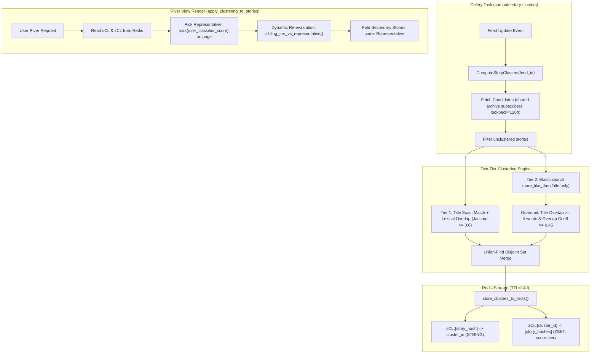

# STORY01B Research: Audited NewsBlur Reference Architecture

- **Track:** STORY-01B-R
- **Topic:** Audited Reference Architecture — NewsBlur Story Clustering
- **NewsBlur Reference HEAD:** `d7c61b5b3ed7a991a2385b1991449085029711d6` (`samuelclay/NewsBlur`)
- **NewsFlux Base Commit:** `dc4154d7729204c65c8a1abaa50f9bfc9f92be64`
- **Date:** 2026-10-25
- **Status:** COMPLETE / RESEARCH ONLY
- **Runtime Activation:** NONE (`NO PRODUCT ACTIVATION`, `MERGE=NO`, `DEPLOY=NO`)

---

## 1. Executive Summary

This document presents an exhaustive architectural audit of the story clustering implementation in `samuelclay/NewsBlur` (commit `d7c61b5b3ed7a991a2385b1991449085029711d6`), evaluating its two-tier clustering engine, storage model, client presentation, and algorithmic failure modes to inform the future NewsFlux **Story Identity Engine**.

NewsBlur introduced duplicate story clustering in March 2026 to group cross-feed duplicate stories and related coverage in its "River of News" view. While NewsBlur successfully reduces headline duplication, its core design relies on **unrestricted union-find graph merging**, which inherently suffers from **transitive chaining** ($A \sim B \land B \sim C \implies A \sim C$). To survive in production, NewsBlur had to introduce complex runtime workarounds: recomputing similarity against the chosen representative at render time, enforcing ad-hoc same-feed guards, and accepting substantial editorial drift.

For NewsFlux, where the future product projection is **strict Home editorial grouping** with **zero corruption of chronological All/Unread views**, unrestricted union-find is explicitly **rejected**. NewsFlux adopts an asymmetric loss policy:

$$\text{Cost}(\text{False Merge}) \gg \text{Cost}(\text{False Split})$$

---

## 2. NewsBlur Clustering Pipeline Overview

NewsBlur implements duplicate clustering in two primary files:

- `apps/clustering/models.py` (core clustering logic, union-find algorithms, Redis storage, river view folding)
- `apps/clustering/tasks.py` (Celery background tasks, candidate selection, feed-level orchestration)
- Supporting context: `blog/_posts/2026-03-18-story-clustering.md` (rationale and user-facing design)



---

## 3. Audited Constants and Parameters

The exact production constants audited in `apps/clustering/models.py` and `apps/clustering/tasks.py` are:

| Parameter                         | Value                 | Definition / Purpose in NewsBlur                                                          |
| :-------------------------------- | :-------------------- | :---------------------------------------------------------------------------------------- |
| `CLUSTER_TTL_SECONDS`             | `1,209,600` (14 days) | Redis TTL for cluster membership keys (`sCL:`, `zCL:`, `sCLt:`, `zCLt:`).                 |
| `CLUSTER_LOOKBACK_HOURS`          | `120` (5 days)        | Temporal lookback window for candidate generation across related feeds.                   |
| `CLUSTER_MAX_SIZE`                | `10`                  | Maximum number of stories allowed in a single cluster.                                    |
| `TITLE_MIN_LENGTH`                | `10`                  | Minimum character length for normalized titles to enter clustering.                       |
| `FUZZY_MIN_WORDS`                 | `5`                   | Minimum significant words in title required for fuzzy lexical matching.                   |
| `FUZZY_SIMILARITY_THRESHOLD`      | `0.6`                 | Minimum title overlap coefficient for Tier 1 fuzzy match.                                 |
| `FUZZY_MIN_INTERSECTION`          | `3`                   | Minimum intersecting significant words for Tier 1 fuzzy match.                            |
| `SEMANTIC_MIN_TITLE_INTERSECTION` | `4`                   | Guardrail: Minimum title word intersection to accept an ES MLT match.                     |
| `SEMANTIC_MIN_OVERLAP_COEF`       | `0.45`                | Guardrail: Minimum overlap coefficient to accept an ES MLT match.                         |
| `CANDIDATE_FEED_BATCH_SIZE`       | `50`                  | Pipeline batch size for querying Redis candidate hashes (`zF:`).                          |
| `CLUSTER_KEY_PREFIX_RELATED`      | `"sCL"`               | Redis key prefix for merged title + related cluster pointer (`sCL:<hash> -> cluster_id`). |
| `CLUSTER_ZKEY_PREFIX_RELATED`     | `"zCL"`               | Redis sorted set prefix for merged cluster members (`zCL:<cluster_id>`).                  |
| `CLUSTER_KEY_PREFIX_TITLE`        | `"sCLt"`              | Redis key prefix for title-only cluster pointer (`sCLt:<hash> -> cluster_id`).            |
| `CLUSTER_ZKEY_PREFIX_TITLE`       | `"zCLt"`              | Redis sorted set prefix for title-only cluster members (`zCLt:<cluster_id>`).             |
| `CLUSTER_TIER_TITLE_SCORE`        | `1`                   | ZSET score designating Tier 1 title-match sibling.                                        |
| `CLUSTER_TIER_RELATED_SCORE`      | `2`                   | ZSET score designating Tier 2 semantic related sibling.                                   |

---

## 4. Deep Dive: The Two-Tier Clustering Engine

### 4.1 Tier 1: Title-Based Lexical Clustering

1. **Exact Title Matching ($O(N)$):**
   - Titles are normalized: lowercased, non-alphanumeric punctuation stripped, whitespace collapsed.
   - Filtered by `TITLE_MIN_LENGTH >= 10`.
   - Exact string matches across different resolved feeds (`feed_id != other_feed_id`) are unioned.
   - Branched feeds sharing an `original_feed_id` are treated as identical feeds to prevent false self-clustering.
2. **Fuzzy Significant-Word Matching:**
   - Stopwords (standard English stopword set) and feed title tokens (`feed_title_map`) are stripped.
   - Requires $\ge 5$ significant words (`FUZZY_MIN_WORDS`).
   - Pairs are indexed via an inverted word index with a frequency cap (words appearing in $>50$ candidates are skipped).
   - Candidate pairs must have $\ge 3$ intersecting words (`FUZZY_MIN_INTERSECTION`).
   - Rather than standard Jaccard ($\frac{|A \cap B|}{|A \cup B|}$), NewsBlur computes the **overlap coefficient**:
     $$\text{Overlap}(A, B) = \frac{|A \cap B|}{\min(|A|, |B|)}$$
   - _Rationale in NewsBlur:_ Aggregators (e.g. Techmeme, Google News) append source attribution and context, making headlines $2\times$ to $3\times$ longer. Standard Jaccard heavily penalizes asymmetric headline lengths, whereas overlap coefficient allows a concise headline to match an aggregated headline if most of the concise headline's words appear in the longer headline.
   - Threshold: $\text{Overlap}(A, B) \ge 0.6$.

### 4.2 Tier 2: Elasticsearch `more_like_this` Semantic Clustering

1. **Candidate Scope:**
   - Evaluates only unclustered stories (`cluster_checked=False`).
   - Targets candidate feeds subscribed to by active archive subscribers of the current feed (capped at 50 users, 200 feeds).
2. **Query Construction:**
   - Query text: **Title only** (content is excluded from the query body to prevent topical noise from sprawling body text).
   - Fields searched: `["title", "content"]` in the Elasticsearch index.
   - Parameters: `min_term_freq=1`, `min_doc_freq=2`, `min_word_length=3`, `max_query_terms=25`, `size=5`.
3. **Guardrails Against Semantic Drift:**
   - ES relevance score alone was found by NewsBlur to produce severe topical false positives (e.g., matching any two articles containing "Apple" and "App").
   - Consequently, NewsBlur enforces two mandatory lexical guardrails before accepting an ES hit:
     1. Shared significant title words $\ge 4$ (`SEMANTIC_MIN_TITLE_INTERSECTION`).
     2. Title overlap coefficient $\ge 0.45$ (`SEMANTIC_MIN_OVERLAP_COEF`).
   - Pairs passing both guardrails are unioned into the cluster graph.

---

## 5. Storage and Client Presentation Layer

### 5.1 Redis Dual Namespace

NewsBlur maintains two parallel cluster universes in Redis:

- `sCLt:` and `zCLt:` (Title-only matches, Tier 1)
- `sCL:` and `zCL:` (Merged Title + Related matches, Tier 1 + Tier 2)

Each cluster entry has a 14-day TTL (`CLUSTER_TTL_SECONDS`). When an incoming story matches an existing cluster, the story is appended to the existing cluster's sorted set (`ZADD`) and the TTL on the entire cluster is refreshed.

### 5.2 River View Folding (`apply_clustering_to_stories`)

When a user loads their river feed:

1. NewsBlur fetches the page of stories.
2. It queries Redis `sCL:` for all story hashes on the page.
3. For any clustered stories, it pulls the complete cluster membership from `zCL:`.
4. **Representative Selection:**
   - NewsBlur sorts all on-page cluster members by the user's **intelligence score** (`score` computed from user classifier feeds, authors, tags, and titles).
   - The member with the highest intelligence score is designated the **cluster representative**.
5. **Presentation:**
   - The non-representative on-page members are removed from the river stream.
   - Sibling metadata is attached to the representative in `cluster_stories`.
   - In the frontend, the representative is rendered as the primary card, with an expandable badge indicating $N$ duplicate/related articles.

---

## 6. Detailed Failure Mode Analysis: The Transitive Chaining Flaw

The most critical insight from the NewsBlur audit is the failure mode of **unrestricted union-find graph merging**:

### 6.1 The Mathematical Flaw

In union-find, equivalence is transitive:
$$A \sim B \land B \sim C \implies A \sim C$$

In news publishing:

- Article $A$: _"Federal Reserve holds interest rates steady at 5.25%"_
- Article $B$: _"Markets react as Fed holds rates steady while Tech sector rallies"_
- Article $C$: _"NVIDIA announces new Blackwell Ultra AI GPU amid tech market rally"_

Here, $A$ and $B$ share rate-hold terms ($A \sim B$). $B$ and $C$ share market rally and tech sector terms ($B \sim C$).
Under union-find, $A$, $B$, and $C$ collapse into the **same cluster**.
However, Article $A$ (monetary policy) and Article $C$ (semiconductor hardware launch) have **zero event connection**!

### 6.2 Defensive Patches in NewsBlur Code

NewsBlur's codebase contains explicit evidence of this breakdown:

1. **Merge-Time Guard (`models.py`, lines 827–839):**
   ```python
   # Validate title-word overlap with existing cluster members.
   # If title data is available, require >= FUZZY_MIN_INTERSECTION
   # shared words with at least one existing member.
   has_overlap = any(
       len(new_words & ew) >= FUZZY_MIN_INTERSECTION for ew in existing_title_words
   )
   ```
   _Flaw:_ Checking `any(...)` still permits arbitrary transitive drift across sequential runs: $A \to B \to C \to D$.
2. **Render-Time Dynamic Re-evaluation (`models.py`, lines 1176–1206):**
   Because the precomputed cluster membership cannot be trusted to be mutually coherent, NewsBlur **recomputes similarity against the chosen representative on the fly** during river rendering:
   ```python
   # Recompute each member's tier against the chosen representative once...
   member_tier = sibling_tier_vs_representative(...)
   ```
3. **Same-Feed Leakage Guard (`models.py`, lines 1208–1216):**
   When two distinct articles from the _same_ feed were transitively linked through third-party reposts, NewsBlur collapsed the publisher's own articles into each other. NewsBlur had to write an emergency exemption:
   ```python
   # A different story from the representative's own feed that only matches it as "related"
   # is not a duplicate. It keeps its own row and is never listed as a sibling...
   if sib_feed_id == rep_feed_id and member_tier != CLUSTER_TIER_TITLE:
       same_feed_related_hashes.add(member_hash)
   ```
4. **Representative Volatility:**
   Because the representative is selected by user intelligence score (`score`), two users subscribed to the same feeds will select _different_ representatives. Consequently, the dynamic tier check produces inconsistent cluster compositions for different users, destroying editorial reproducibility.

---

## 7. NewsBlur vs. NewsFlux Comparison Matrix

| Dimension                 | `samuelclay/NewsBlur`                                                                       | `jfsdias/NewsFlux` (Native Architecture)                                                                                    |
| :------------------------ | :------------------------------------------------------------------------------------------ | :-------------------------------------------------------------------------------------------------------------------------- |
| **Product Scope**         | River of News (global feed stream)                                                          | **Home only** (All and Unread remain strictly chronological and unclustered)                                                |
| **Semantic Goal**         | Broad related-story grouping ("River dedup")                                                | **Strict Same-Event Identity** ("Did these outlets report the exact same news event?")                                      |
| **Candidate Generation**  | Elasticsearch `more_like_this` (Title only)                                                 | Dense vector search via **Qwen 1024-dim embeddings** (cross-feed, 168h window)                                              |
| **Pairwise Verification** | Lexical overlap coefficient ($\ge 0.45$)                                                    | Cross-encoder **`Qwen3-Reranker-0.6B`** + deterministic lexical & temporal rules                                            |
| **Graph Topology**        | **Unrestricted Union-Find** (transitive merging)                                            | **Strict Pairwise Thresholding**; unrestricted union-find is **EXPLICITLY REJECTED**                                        |
| **Loss Asymmetry**        | Symmetric / Serendipity-tolerant (false merges are considered harmless "related" content)   | Asymmetric: **$\text{Cost}(\text{False Merge}) \gg \text{Cost}(\text{False Split})$** (Precision prioritized over recall)   |
| **User Invariance**       | Non-invariant (representative depends on user classifiers and personal intelligence scores) | **Completely Invariant** (`SAME_EVENT` is an objective property of the articles, independent of read state or user profile) |
| **Storage / State**       | Redis sorted sets (`sCL:`, `zCL:`) with 14d TTL                                             | Local SQLite / Postgres metadata cache; Miniflux upstream remains untouched                                                 |
| **Miniflux Impact**       | N/A (NewsBlur is its own backend)                                                           | **Zero writes** (`MINIFLUX_WRITES=0`); no category, feed, or entry mutations                                                |

---

## 8. Implications and Decisions for NewsFlux

1. **Rejection of Unrestricted Union-Find:**
   `UNRESTRICTED_UNION_FIND_FOR_FINAL_CLUSTERING=REJECTED`. NewsFlux must require clique completeness or strict medoid/representative similarity thresholds before forming any multi-article cluster.
2. **Decoupling from Personalization:**
   Editorial story identity (`SAME_EVENT`) must be determined purely by article content, publication timing, and source metadata. Read/unread status, star marks, user scoring, and feed affinities must not alter event boundaries.
3. **Temporal Hard Bounds:**
   NewsBlur uses a loose 120h window. NewsFlux empirical data on real news bursts demonstrates that over 90% of cross-feed same-event coverage arrives within 6 hours of the initial report.
4. **Lexical Guardrail Retention:**
   NewsBlur's finding that lexical overlap is an essential safeguard against semantic model hallucinations is confirmed. Even with modern dense embeddings and rerankers, exact entity/keyword overlap serves as an indispensable precision filter.
